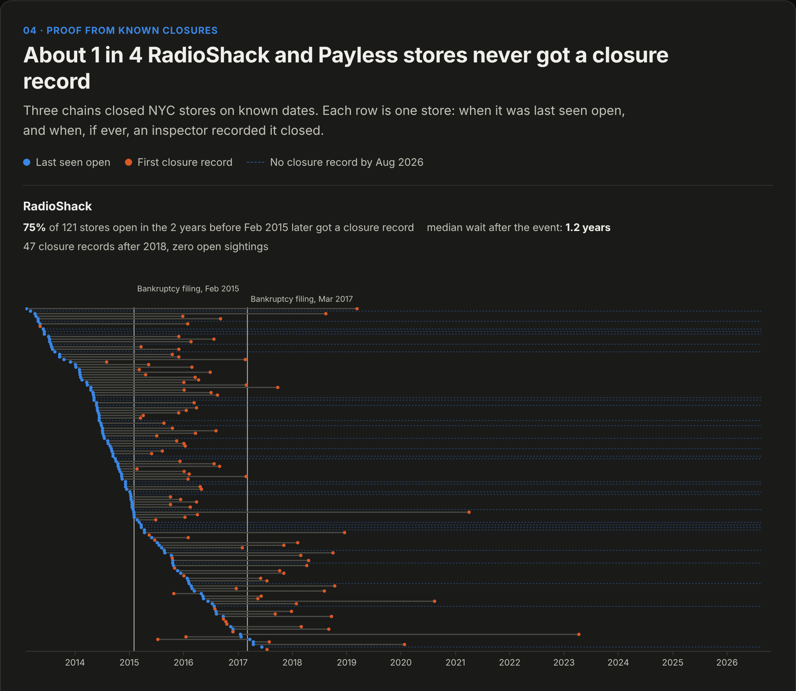
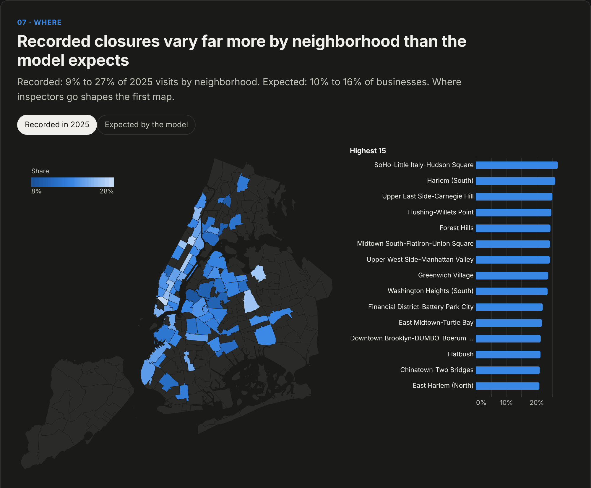

# Ghost Storefronts

**How stale is New York City's record of which businesses are open?**



**[Interactive data story](https://jacobwillson.com/ghost-storefronts/)** · [Notebooks](notebooks/)

New York's Department of Consumer and Worker Protection inspects licensed storefronts. When an
inspector finds a business gone, the visit is recorded as out of business. The city only learns
a business closed when someone visits, so its list of open businesses is only as current as the
last inspection. This project rebuilds 1,182,668 storefront inspection records (2010 to August
2026) in MongoDB, measures how stale that record gets, checks it against three chains that
closed on known dates, and predicts which visits will find a business already closed.

## Findings

- **17.4% of 2025 inspection visits found the business already closed**, up from 4.5% in 2010
  to 2013. This tracks what inspectors recorded, which depends on where and why they go.
- **48% of 2025 closure records were for businesses last seen open three or more years
  earlier.**
- **Patrol inspections produce 59% of closure records.** The program that sends the inspector
  largely sets the rate.
- **Known closures are recorded late or not at all.** Of stores open in the two years before
  each chain's collapse, 75% of RadioShack and Payless stores and 57% of Rite Aid stores later
  got a closure record. Median wait after the event: 1.2, 5.1 and 2.1 years.
- **A one-line rule does most of the predictive work.** Ranking visits by months since a
  business was last seen open puts a closed business in 55% of the top 10%. The best model
  using the same history adds 2.9 points on 2025 data and 8.9 on 2019 data. Default LightGBM
  does not beat the rule on 2019 data (-0.7 points, 95% CI -2.1 to +0.9).
- **About 5,722 of the 43,447 businesses seen open since 2023 would be recorded closed if
  visited today** (95% interval 5,443 to 5,986, calibration uncertainty only).



## How it works

1. **Ingest.** Paged pulls from NYC Open Data (archive 2010 to 2023, live system 2023 on)
   load into raw MongoDB collections unchanged. MongoDB's 2015 `sample_training.inspections`
   collection is matched back to the archive for lineage.
2. **Silver.** One schema across both record systems, with outcome and industry crosswalks
   in `config/`.
3. **Geography and identity.** A `2dsphere` index and `$geoWithin` assign each location to an
   NTA 2020 neighborhood. Businesses are linked across the July 2023 record-system switch.
4. **Gold.** `$setWindowFields` builds one row per visit with features from earlier visits
   only, written with `$merge`. `reports/gold_audit.json` checks for leakage.
5. **Models.** Staleness rule, logistic regression and LightGBM, trained on earlier years and
   tested on a later one. Platt calibration and business-clustered bootstrap intervals.
6. **Outputs.** Four notebooks, CSV exports and a self-contained HTML data story.

## Notebooks

| Notebook | Question |
|---|---|
| `01_eda.ipynb` | What does the record look like, by year, program, industry and neighborhood? |
| `02_ground_truth.ipynb` | Does a closure record catch real closures? (RadioShack, Payless, Rite Aid) |
| `03_model.ipynb` | Can a closed business be predicted before the visit? |
| `04_ghost_count.ipynb` | How many businesses on the books would be recorded closed today? |

## Run it

Requires Python 3.11+, [uv](https://docs.astral.sh/uv/) and Docker with Compose for MongoDB.
For sample lineage, supply MongoDB's `sampledata.archive` file. Run targets one at a time:

```bash
uv sync --locked                                      # Install the pinned environment
cp .env.example .env                                  # Set local connection and download options
make up                                               # Start MongoDB on port 27018
make ping                                             # Check the database connection
make restore ARCHIVE=/path/to/sampledata.archive       # Restore the 2015 sample
make download                                         # Download inspection records; several minutes
make load-raw                                         # Load the downloaded records
make copy-sample                                      # Copy the 2015 sample for lineage joins
make silver                                           # Normalize and validate inspection records
make indexes                                          # Create secondary indexes
make link-sample                                      # Match sample records to the archive
make boundaries                                       # Download NTA 2020 boundaries
make nta                                              # Assign neighborhoods by location
make link-switch                                      # Link identities across the 2023 system switch
make profile                                          # Write the data-quality report
make gold                                             # Build visit features and audit; about 76 seconds
make notebooks                                        # Execute all four notebooks; about 37 seconds
make exports                                          # Write ten CSVs; about 3 seconds
make dashboard                                        # Write docs/index.html; about 2 seconds
make lint                                             # Check Python and notebook style
make test                                             # Run unit and isolated integration tests; about 3 seconds
```

With the annotated source data already available, start at `make gold`. Downloads and source
processing depend on network speed and hardware. Integration tests use temporary databases.
Other commands: `make status` lists collection counts, `make down` stops MongoDB while keeping
its data volume, and `make help` lists every target.

## Limits

- A closure record needs a visit. Rates reflect where and why inspectors went, not how fast
  businesses close.
- A business is a linked identity in the record. Name and unit changes can split one shop.
- The estimate means "would be recorded closed if visited," from a model trained only on
  visits the city chose to make.
- Measures that were tested and dropped because the data could not support them: storefront
  turnover, reopenings after padlock orders, and vacancy.

## Repository layout

| Folder | Contents |
|---|---|
| `config/` | Data sources and outcome and industry crosswalks |
| `data/` | Local downloads and geographic boundaries; generated data ignored |
| `docs/` | Self-contained HTML data story and space for README images |
| `exports/` | CSV column dictionary; generated CSVs ignored |
| `notebooks/` | Four executed analyses |
| `reports/` | Chain results, model metrics, estimate, gold audit, data quality and SHAP chart |
| `src/storefronts/` | Data processing, analysis, exports and dashboard code |
| `tests/` | Unit tests and integration tests using isolated databases |

## Data

NYC Department of Consumer and Worker Protection inspections via NYC Open Data, and NYC
Department of City Planning NTA 2020 boundaries:
[archived inspections](https://data.cityofnewyork.us/resource/kwss-yksz.json),
[current inspections](https://data.cityofnewyork.us/resource/jzhd-m6uv.json), and
[NTA 2020 boundaries](https://data.cityofnewyork.us/api/v3/views/9nt8-h7nd/query.geojson?accessType=DOWNLOAD).
